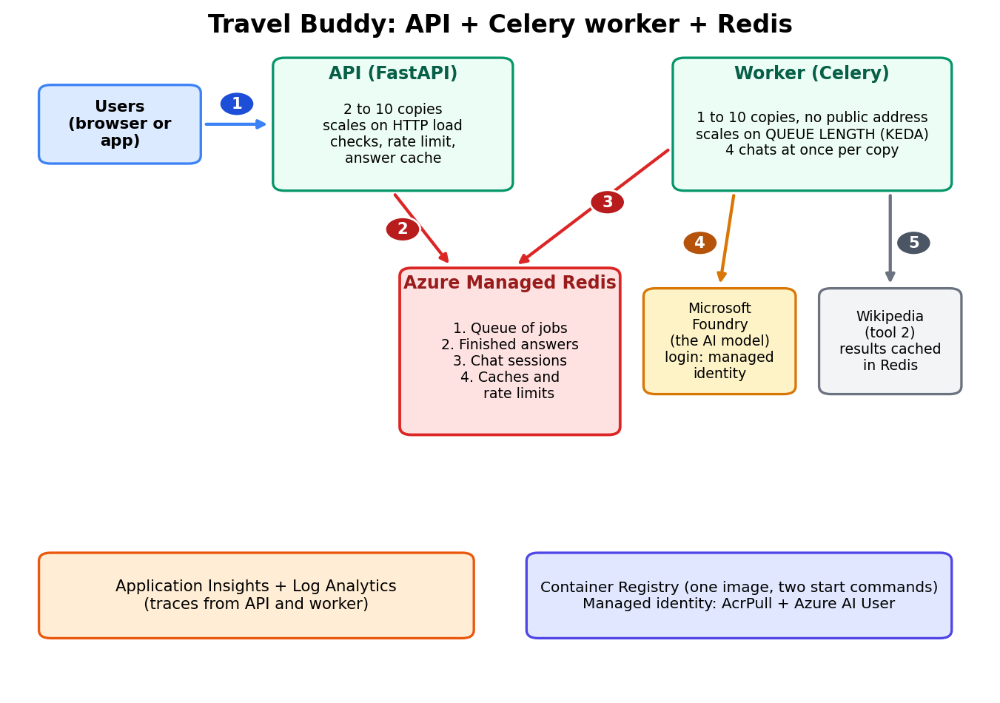

# Travel Buddy on Azure (FastAPI + Celery worker + Redis, on Container Apps)

The Travel Buddy agent from the course, as a web API that you can run in Azure. It can also be placed inside an Azure **landing zone** (see "Landing zone options").



(`landing_zone.png` shows how the same system sits inside a landing zone.)

## How it works in one minute

1. A user sends a message to the **API** (`POST /chat`). The API checks it, applies a per-user **rate limit**, looks in the **answer cache**, and otherwise puts a **job on the queue** in **Redis**. It replies at once with a job id (HTTP 202).
2. A **Celery worker** takes the job, loads that chat's history from Redis, asks the model (and runs the tools), saves the history, and leaves the answer in Redis.
3. The user's app asks `GET /chat/{task_id}` every second or so until the status is `done`.

Why: a chat takes seconds. Without a queue, hundreds of waiting users would use up every connection and hit the model's rate limit together. With a queue, the API stays fast and the number of workers decides how hard the model is pushed. Both parts scale on their own: the API on HTTP load, the workers on queue length.

## What Redis does here (four jobs, one server)

| Job | Keys | Purpose |
|-----|------|---------|
| Celery broker | list `celery` | the waiting line of jobs |
| Celery results | `celery-task-meta-*` | finished answers, kept one hour |
| Chat sessions | `tb:session:<id>` | any worker can continue any chat (sliding window of 20 messages, 1 hour of silence) |
| Caches and limits | `tb:wiki:*`, `tb:answer:*`, `tb:rate:*`, `tb:lock:*` | fewer Wikipedia and model calls, per-user limit, one job per chat at a time |

## What is in this folder

| Path | What it is |
|------|------------|
| `app/main.py` | The API: `POST /chat`, `GET /chat/{task_id}`, `GET /health`, `GET /ready` |
| `app/celery_app.py` | The queue settings (shared by API and worker) |
| `app/tasks.py` | The job the worker runs |
| `app/agent_setup.py` | Builds the client and agent (worker only) |
| `app/sessions.py` | Saving and trimming chat history in Redis |
| `app/redis_util.py` | One place that connects to Redis |
| `app/tools.py` | The two tools (Wikipedia results are cached) |
| `Dockerfile` | One image. Runs as the API or, with another command, as the worker |
| `docker-compose.yml` | Redis + API + worker on your laptop (needs Docker) |
| `infra/main.bicep` | Creates the Azure resources |
| `infra/foundry-access.bicep` | Gives the identity permission to use your Foundry account |
| `deploy.ps1` | One script that deploys everything (PowerShell) |
| `smoke_test.py` | Quick functional test |
| `load_test.py` | Pretend-users test, to measure instead of guess |

## What the Bicep template creates

Log Analytics and Application Insights, **Azure Managed Redis**, a Container Registry, a user-assigned managed identity, a Container Apps environment, the **API app** (2 to 10 copies, scales on HTTP load) and the **worker app** (1 to 10 copies, no public address, scales on the length of the Redis queue with KEDA). Roles: **AcrPull** (pull the image) and **Azure AI User** on your existing Foundry account. It does **not** create the Foundry account or model.

## Prerequisites

- An Azure subscription (active, with budget) and permission to create resources and role assignments (for example Owner on the resource group)
- The Azure CLI, and `az login`
- An existing Microsoft Foundry account and project with a model deployment (for example `gpt-4.1-mini`)
- No Docker on your laptop is needed. The image is built inside Azure

## Step 1: Test on your laptop first (optional)

Easiest, with Docker installed: put your settings in a `.env` file (copy `.env.example`, use the OpenAI key option) and run:

```powershell
docker compose up --build
python smoke_test.py http://localhost:8000
```

Without Docker you still need a Redis (WSL, Memurai, or a small Azure Managed Redis). Then, in two terminals inside the `app` folder:

```powershell
uvicorn main:app --reload
celery -A celery_app:celery_app worker --loglevel=info --pool=solo
```

(`--pool=solo` is the Windows-friendly worker mode for testing.) Open http://localhost:8000/docs to try the API.

## Step 2: Check the template

```powershell
az bicep build --file infra/main.bicep
```

This should finish with no errors. (This template was written and checked by reading and structure only; this is the first real check.)

## Step 3: Deploy

```powershell
.\deploy.ps1 -ResourceGroup rg-travelbuddy -Location eastus `
    -FoundryAccountName my-foundry-account `
    -FoundryProjectEndpoint "https://my-foundry-account.services.ai.azure.com/api/projects/my-project"
```

The script runs four stages: create the resource group, create everything except the two apps (Redis can take 10 to 20 minutes), build the image in the registry, then create the API and the worker. At the end it prints the API URL.

## Step 4: Test it

```powershell
python smoke_test.py https://YOUR-API-URL
```

Then measure how it behaves under load (start small, every uncached question calls the model and costs money):

```powershell
pip install httpx
python load_test.py https://YOUR-API-URL --users 20
python load_test.py https://YOUR-API-URL --users 100
```

Watch the worker's **Replicas** in the portal grow as the queue grows.

Role assignments can take a few minutes to start working, so if the first call gives a 401 or 403 error, wait a few minutes and try again.

## Step 5: Look at the monitoring

Open the Application Insights resource (`appi-travelbuddy`) in the portal and use Live metrics and Logs, as in steps 19 and 20 of the course.

## Update the app

Change the code, then rebuild with a new tag and redeploy:

```powershell
.\deploy.ps1 ... -ImageTag v2
```

## Clean up (stops the costs)

```powershell
az group delete --name rg-travelbuddy --yes --no-wait
```

## Landing zone options

If your organisation gives you a landing zone subscription, the platform team usually provides a virtual network. Pass a subnet and make the app internal:

```powershell
.\deploy.ps1 ... -InfrastructureSubnetId "/subscriptions/.../subnets/snet-containerapps" -InternalOnly
```

Requirements and limits:
- The subnet must be **delegated to `Microsoft.App/environments`** and large enough (the platform team will know the size rules).
- `-InternalOnly` makes the app reachable only from inside the virtual network.
- This template does **not** create private endpoints, private DNS zones, firewall rules, or policies. In a landing zone, the Foundry account, registry and Key Vault normally use private endpoints, and outbound traffic (for example to Wikipedia) must be allowed by the firewall. Microsoft's baseline architecture and the Azure AI Landing Zones project show how.
- Add any tags your organisation requires through the `tags` parameter, because policies often deny resources without them.
- With a private registry or network rules, building with `az acr build` may need extra setup. The platform team can advise.

## Scaling for many users: what to tune

| Setting | Where | Meaning |
|---------|-------|---------|
| Model quota | Foundry, your deployment | Usually the FIRST limit. Request more tokens per minute, or use provisioned throughput |
| `workerMaxReplicas` x `workerConcurrency` | Bicep / deploy.ps1 | The most chats the model is asked at the same moment (default 10 x 4 = 40). Keep it below what your quota allows |
| `queueLengthPerReplica` | Bicep | Jobs waiting per worker copy before another copy is added |
| `apiMinReplicas` / `apiMaxReplicas` | Bicep | API copies. 2 or more means no single point of failure |
| `rateLimitPerMinute` | Bicep | Messages per person per minute |
| `ANSWER_CACHE_TTL`, `WIKI_CACHE_TTL` | env vars | How long answers and Wikipedia results are reused |
| `redisSku` | Bicep | Redis size. Grow it if memory use is high |

## Security notes

- No API keys or passwords are stored in the code. The app signs in with its managed identity.
- `ENABLE_SENSITIVE_DATA` is `false` in Azure, so prompts and answers are not recorded in monitoring.
- The input guardrail is simple pattern matching. For real use, add Azure AI Content Safety.
- The default deployment has a public URL with no login. For real use, turn on Container Apps authentication (Microsoft Entra ID). The rate limit then uses the signed-in user's id. Without it, the `X-User-Id` header is easy to fake.
- The Redis access key is stored as a Container Apps secret and is placed in the template by `listKeys()`. It is also visible to anyone who can read the deployment history. For production, prefer Microsoft Entra authentication for Redis, or a Key Vault reference.
- The Redis endpoint is public (key plus TLS) by default. In a landing zone, use a private endpoint.
- Celery uses JSON only, never pickle.
